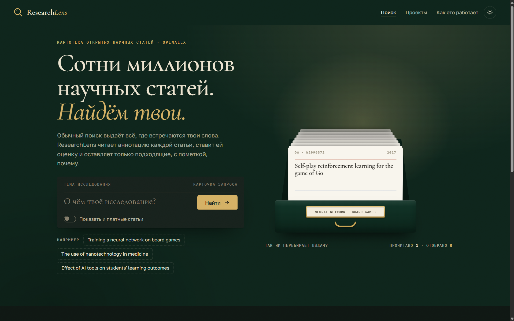
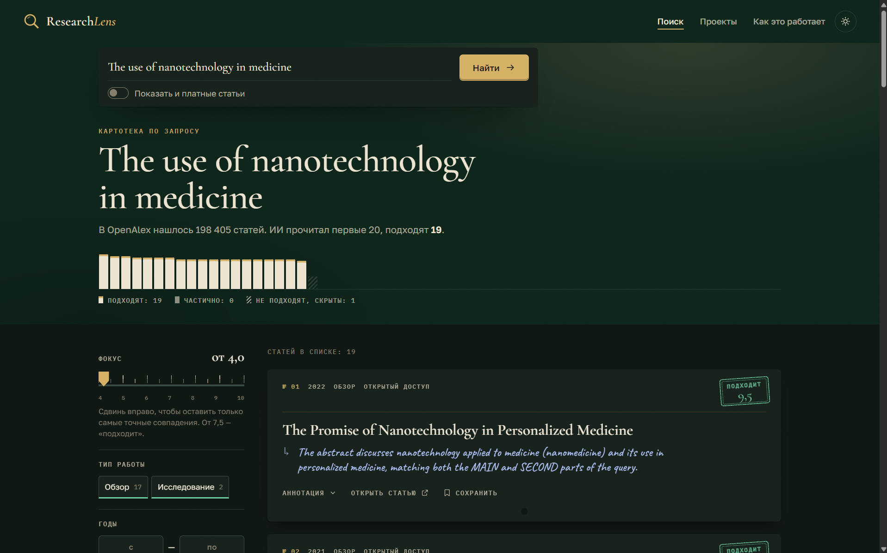

# ResearchLens

An AI guide that searches hundreds of millions of research papers and keeps only the ones that actually fit your topic, with a one-line reason for each.



## Why I built it

In June 2026 I started a research paper on how quickly an AI reaches a plateau during training. I found more than 2,000 papers, and reading and judging each one took me over two hours. Most of them only applied machine learning in other fields, such as chemistry or biology, but search engines still showed them because the words matched. I built ResearchLens so that students like me can skip that filtering and spend their time on the papers that matter.

## How it works

1. **Search.** The query goes to [OpenAlex](https://openalex.org), an open database of research papers. Duplicate records of the same paper are removed.
2. **Reading.** An AI model (gpt-oss-20b) reads the title and abstract of each of the first 20 papers. It splits the query into the main part, the secondary part and details, and gives every paper a score from 1 to 10 with a one-sentence reason.
3. **Filtering.** Papers scored 7.5+ are shown as fitting, 4.0–7.4 as partly fitting, and the rest are hidden. Papers without an abstract are not scored but are listed separately, so the user can check them.
4. **Working with results.** Filters by score, year, topic and type of work; a “check 20 more” button; typo correction; projects to save papers in. The interface is in Russian.



## Results so far

- **Speed:** reviewing 20 papers by hand took me 40–70 minutes; ResearchLens scores them in about 5.5 seconds.
- **Accuracy:** on 60 papers I rated by hand, the chosen model matched my judgement in 71.7% of cases (80% if “fits” and “partly fits” are treated as one group). For comparison, the first 20 Google Scholar results for my own query had 15% strict and 40% soft accuracy.
- **Model choice:** I compared three models on the same 60 papers for accuracy, stability and speed before choosing gpt-oss-20b.

My goal of 80% strict accuracy is not reached yet; the next step is to test the improved instructions for the AI on the same papers.

## Run it locally

You need Python 3.10+ and a free [Groq](https://console.groq.com) API key. Download this repository (**Code → Download ZIP**) or clone it, then in its folder run:

```bash
pip install -r requirements.txt
copy .env.example .env     # on macOS/Linux: cp .env.example .env
```

Open `.env`, paste your key into `GROQ_API_KEY`, then start the site:

```bash
python app.py
```

and open http://127.0.0.1:5000. Tests: `python -m pytest`.

## Documentation

- [Project documentation](docs/documentation.md): goal, hypothesis, choice of the database and the model, all test results
- [Development diary](docs/dev-diary.md): how the project developed, from the June 2026 prototype to now
- [`legacy/prototype-june-2026`](legacy/prototype-june-2026): the first prototype

## Built with

Python, Flask, SQLite, OpenAlex API, Groq (gpt-oss-20b). The code was written with Claude as a coding assistant; I designed the features, directed the development, reviewed the code, tested the platform and wrote the documentation.

## License

[MIT](LICENSE)
